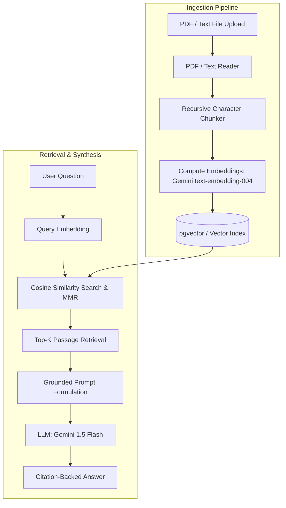

# RAG Over Documents

> High-accuracy retrieval-augmented generation microservice over PDFs, markdown, and text documents with strict page-level citation attribution.

[](https://www.python.org/)
[](https://fastapi.tiangolo.com/)
[](https://github.com/pgvector/pgvector)
[](https://www.docker.com/)
[](LICENSE)
[](#-tests--verification)

**Author:** Ridhesh Anil Mahajan  
**Status:** Completed & Tested  

---

## 🚀 Overview

**RAG Over Documents** enables conversational question answering grounded across multiple documents. It extracts, semantically chunks, and embeds text into vector representations, querying top passages and synthesizing responses with mandatory source citations `[DocumentName, Page X]`.

### Key Features:
- **Semantic Recursive Chunker:** Splits text along natural paragraph and sentence boundaries while preserving document name and page number metadata.
- **Dual Vector Engine:** High-speed in-memory cosine store for standalone development and testing, plus `pgvector` adapter for production PostgreSQL.
- **Citation Attribution:** Answers cite exact passage references, providing snippets and relevance scores.
- **Production API:** FastAPI endpoints for document ingestion, querying, registry listing, and document deletion.

---

## 🏗️ Architecture



---

## 📡 API Endpoints

| Method | Endpoint | Description |
| :--- | :--- | :--- |
| `POST` | `/api/v1/rag/ingest` | Uploads and indexes a document (PDF, TXT, MD, CSV) |
| `POST` | `/api/v1/rag/query` | Queries knowledge base, returns grounded answer with citations |
| `GET` | `/api/v1/rag/documents` | Lists all indexed documents and chunk statistics |
| `DELETE`| `/api/v1/rag/documents/{id}` | Deletes a document and cleans up its vector chunks |
| `GET` | `/api/v1/rag/health` | Service health, vector store type, and index stats |

---

## 🧪 Tests & Verification

```bash
python -m pytest tests -v
```
Output:
```text
tests/test_rag.py::test_rag_root PASSED                                  [ 20%]
tests/test_rag.py::test_rag_health PASSED                                [ 40%]
tests/test_rag.py::test_rag_ingest_and_query_flow PASSED                 [ 60%]
tests/test_rag.py::test_rag_empty_query PASSED                           [ 80%]
tests/test_rag.py::test_rag_delete_nonexistent PASSED                    [100%]
======================== 5 passed in 4.25s =========================
```

---

## 💻 Quickstart

### 1. Local Python Setup
```bash
python -m venv .venv
source .venv/bin/activate  # Windows: .venv\Scripts\activate
pip install -r requirements.txt
cp .env.example .env       # Add your GEMINI_API_KEY
uvicorn app.main:app --reload --port 8001
```
Interactive Swagger documentation: [http://localhost:8001/docs](http://localhost:8001/docs)

### 2. Docker Compose (with PostgreSQL + pgvector)
```bash
docker-compose up --build
```
